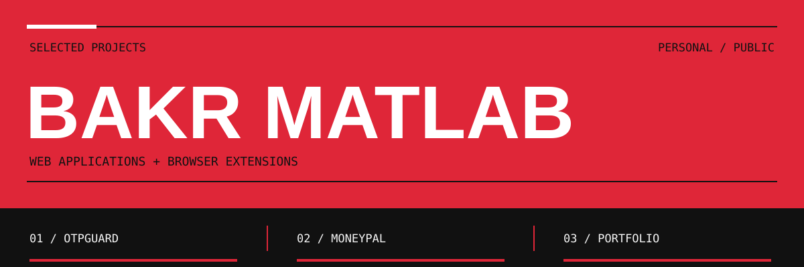

  &nbsp;&nbsp;&nbsp;
  &nbsp;&nbsp;&nbsp;
  &nbsp;&nbsp;&nbsp;
  &nbsp;&nbsp;&nbsp;
  &nbsp;&nbsp;&nbsp;
  

I build web apps and browser extensions. My projects range from getting an email verification code into a login form to tracking money across multiple wallets.

**[Repositories](https://github.com/bakrmatlab?tab=repositories)** &nbsp; / &nbsp; **[OTPGuard website](https://otpguard.net)** &nbsp; / &nbsp; **[Portfolio source](https://github.com/bakrmatlab/portfolio)**

---

### 01 / OTPGuard

**An email code, without the trip back to your inbox.**

A Chrome extension that finds recent Gmail verification codes and lets you choose when to fill them. A companion web dashboard handles setup, connection status, and preferences.

- Gmail tokens, messages, and codes stay inside the extension.
- Filling requires a click; the extension never submits the form.
- Shared OTP and security logic sits alongside the extension and website.

`React` `Next.js` `Convex` `Bun` `Chrome MV3`

[Source & technical notes](https://github.com/bakrmatlab/OTPGuard) &nbsp; / &nbsp; [Website](https://otpguard.net)

The extension is currently installed unpacked; it is not yet available in the Chrome Web Store.

### 02 / MoneyPal

**Multiple wallets. One place to follow the money.**

A personal finance app with deposits, withdrawals, wallet transfers, categories, and an analytics dashboard. Convex keeps data synchronized in real time; Clerk handles authentication.

- Separate wallets with their own colors and icons.
- Categorized transactions and financial charts.
- Light and dark themes across the app.

`React` `Vite` `Convex` `Clerk` `Tailwind CSS` `TanStack Router`

[Source & setup](https://github.com/bakrmatlab/MoneyPal)

### 03 / Portfolio

A separate React and TypeScript project, built with Vite and Tailwind CSS.

[Source](https://github.com/bakrmatlab/portfolio)

---

### Stack, By Job

| Layer | Tools in these projects |
| :--- | :--- |
| Interfaces | React, Next.js, Tailwind CSS |
| Data & authentication | Convex, Clerk |
| Routing & state | TanStack Router, TanStack Query, Zustand |
| Forms & charts | React Hook Form, Zod, Recharts |
| Build & runtime | TypeScript, Vite, Bun |
| Browser | Chrome extensions, Manifest V3 |

### Inside The Repos

OTPGuard includes [architecture decisions](https://github.com/bakrmatlab/OTPGuard/blob/main/documentation/architecture.md), a [threat model](https://github.com/bakrmatlab/OTPGuard/blob/main/documentation/threat-model.md), and synthetic browser tests. MoneyPal documents its [Convex setup](https://github.com/bakrmatlab/MoneyPal#convex-setup) and [project structure](https://github.com/bakrmatlab/MoneyPal#project-structure).

Earlier projects

 

[TheGuardianSearch](https://github.com/bakrmatlab/TheGuardianSearch) &nbsp; / &nbsp; [basic-CRUD-project](https://github.com/bakrmatlab/basic-CRUD-project) &nbsp; / &nbsp; [git_practice](https://github.com/bakrmatlab/git_practice)

---

### After Hours

