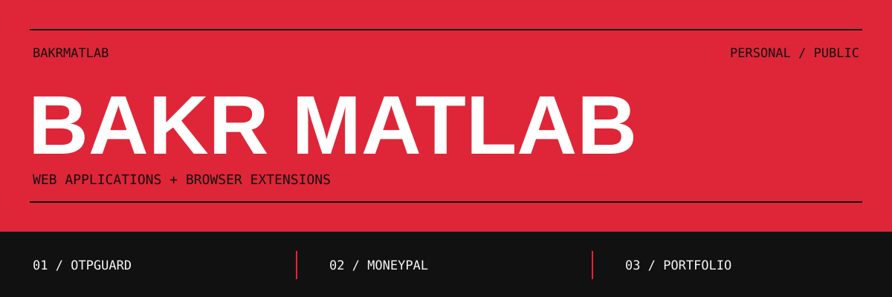

<div align="center">

**Building web apps and browser tools that make everyday tasks easier.**

[Projects](https://github.com/bakrmatlab?tab=repositories) &nbsp;&nbsp;/&nbsp;&nbsp; [OTPGuard](https://otpguard.net) &nbsp;&nbsp;/&nbsp;&nbsp; [Portfolio source](https://github.com/bakrmatlab/portfolio)

</div>

<br>

### On My Workbench

| Project | What it does | Built with |
| :--- | :--- | :--- |
| **[OTPGuard](https://github.com/bakrmatlab/OTPGuard)** | A Chrome extension for finding Gmail verification codes and filling them when you choose. | React, Next.js, Convex, Bun |
| **[MoneyPal](https://github.com/bakrmatlab/MoneyPal)** | Multi-wallet money tracking with real-time sync and financial analytics. | React, Vite, Convex, Clerk |

### Tools I Build With

`React` &nbsp; `Next.js` &nbsp; `Tailwind CSS` &nbsp; `Convex` &nbsp; `Bun` &nbsp; `Vite`

---

```text
bakrmatlab ~ % cat philosophy.txt

Start with an idea.
Make something real.
Keep making it better.
```

<div align="center">
<sub>Always room for the next good idea.</sub>
</div>
