  &nbsp;&nbsp;&nbsp;
  &nbsp;&nbsp;&nbsp;
  &nbsp;&nbsp;&nbsp;
  &nbsp;&nbsp;&nbsp;
  &nbsp;&nbsp;&nbsp;
  

Computer science student at Carleton University. I build web apps and browser extensions with React and TypeScript.

**[Portfolio](https://www.bakrmatlab.com/)** &nbsp; / &nbsp; **[Repositories](https://github.com/bakrmatlab?tab=repositories)** &nbsp; / &nbsp; **[OTPGuard](https://otpguard.net)**

---

### 01 / OTPGuard

A Chrome extension that finds recent Gmail verification codes and fills them when you click **Fill**. Its web dashboard handles setup, connection status, and preferences.

- Gmail tokens and messages stay in the extension; a code goes to the page only when you choose to fill it.
- The extension never submits the form, though a website may continue automatically after filling.

`React` `Next.js` `Convex` `Bun` `Chrome MV3`

[Source & technical notes](https://github.com/bakrmatlab/OTPGuard) &nbsp; / &nbsp; [Website](https://otpguard.net)

Unpacked extension; not yet in the Chrome Web Store. Code matching does not verify that a code belongs to the current website.

### 02 / MoneyPal

A personal finance app that tracks deposits, withdrawals, and transfers across multiple wallets. Convex synchronizes the data; Clerk handles sign-in.

- Wallet colors and icons, transaction categories, and financial charts.
- Light and dark themes.

`React` `Vite` `Convex` `Clerk` `Tailwind CSS` `TanStack Router`

[Source & setup](https://github.com/bakrmatlab/MoneyPal)

### 03 / Portfolio

My personal site, with projects, skills, and background. Built with React, TypeScript, Vite, and Tailwind CSS.

[Website](https://www.bakrmatlab.com/) &nbsp; / &nbsp; [Source](https://github.com/bakrmatlab/portfolio)

---

### Stack

| Layer | Tools in these projects |
| :--- | :--- |
| Interfaces | React, Next.js, Tailwind CSS |
| Data & authentication | Convex, Clerk |
| Routing & state | TanStack Router, TanStack Query, Zustand |
| Forms & charts | React Hook Form, Zod, Recharts |
| Build & runtime | TypeScript, Vite, Bun |
| Browser | Chrome extensions, Manifest V3 |

### Inside The Repos

- OTPGuard: [architecture](https://github.com/bakrmatlab/OTPGuard/blob/main/documentation/architecture.md), [threat model](https://github.com/bakrmatlab/OTPGuard/blob/main/documentation/threat-model.md), and browser tests with synthetic data.
- MoneyPal: [Convex setup](https://github.com/bakrmatlab/MoneyPal#convex-setup) and [project structure](https://github.com/bakrmatlab/MoneyPal#project-structure).

Earlier projects

 

[TheGuardianSearch](https://github.com/bakrmatlab/TheGuardianSearch) &nbsp; / &nbsp; [basic-CRUD-project](https://github.com/bakrmatlab/basic-CRUD-project)

---

### After Hours

